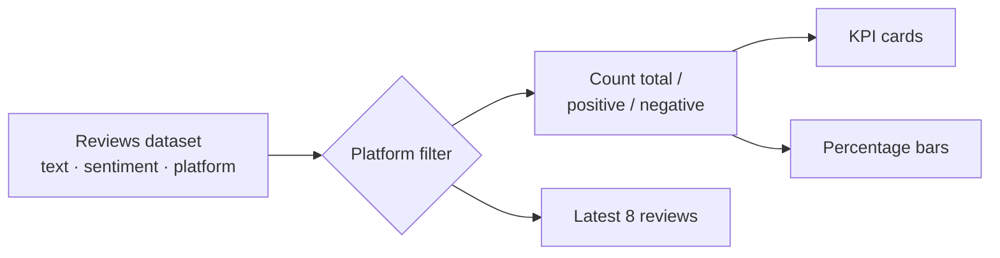

# 📊 Review Analytics Dashboard

A lightweight dashboard prototype that helps e-commerce brands see **how customers feel about their products across Amazon, Flipkart and Myntra**, all in one screen.

Built with **zero dependencies**: one HTML file with plain CSS and vanilla JavaScript. It opens instantly in any browser.


> 📸 _Screenshot coming soon: add `docs/screenshot.png` here._

---

## The problem

A brand selling on several marketplaces gets thousands of reviews in different places. Reading them one by one doesn't scale, and it's hard to answer simple questions like _"Are Flipkart buyers less happy than Amazon buyers?"_

This dashboard is the **front-end design** for a review analytics product. It was built for a product-thinking assignment to show what the brand would see once reviews are collected and classified by sentiment.

## Features

- **KPI cards**: total, positive and negative review counts
- **Platform filter**: switch between All, Amazon, Flipkart and Myntra; every number, chart and list updates instantly
- **Sentiment chart**: positive vs negative split as percentage bars
- **Recent reviews feed**: the latest 8 reviews with platform and colour-coded sentiment tags
- **Responsive layout**: fixed sidebar on desktop that hides on screens under 768 px

## How it works



Everything is driven by one `updateUI()` function. It filters the dataset by the selected platform, recomputes the counts and percentages, and re-renders the cards, chart and review list. The dataset is a built-in sample of 15 labelled reviews.

## Run it

No install or build step:

```bash
git clone https://github.com/JayantBansal900/review-analytics-dashboard.git
cd review-analytics-dashboard
```

Then open `index.html` in your browser (double-click it, or use the VS Code **Live Server** extension).

## Where this goes next

This prototype covers the presentation layer. A production version would add:

- [ ] **Data ingestion**: scheduled scrapers or official APIs for each marketplace
- [ ] **Sentiment model**: an NLP classifier (e.g. a fine-tuned transformer) instead of pre-labelled data, with a neutral class
- [ ] **Backend API** to serve aggregates so the page scales to thousands of reviews
- [ ] **Trends over time**: sentiment by week, by product and by rating
- [ ] **Topic extraction** to surface _why_ customers are unhappy (packaging, sizing, delivery…)
- [ ] **Charting library** (Chart.js / Recharts) for richer visuals

## Author

**Jayant Bansal** · [GitHub](https://github.com/JayantBansal900)
